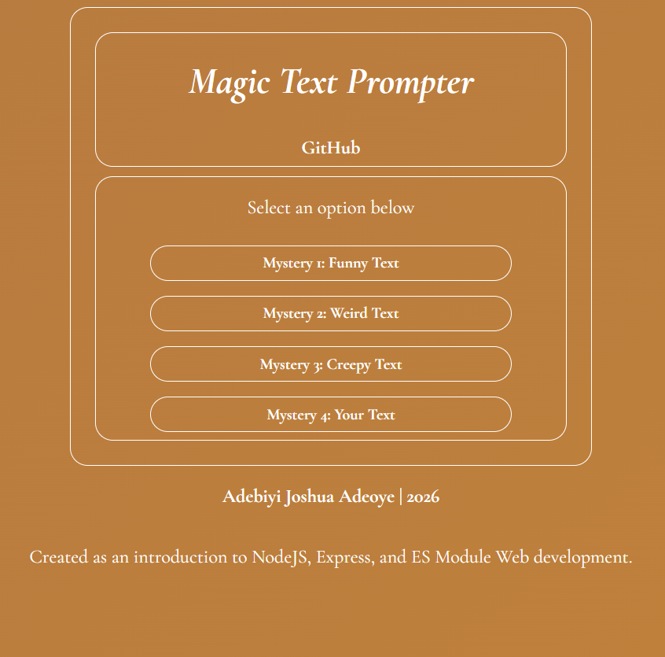

# Magic Text Prompter
_Disclamer: Not magic_

A short-term learning project meant to give myself (Adebiyi Adeoye) a more direct grasp on client, server, and database web communication using Node.js. The project utilizes the Express.js module, with partial implementation of RESTful API principles.

The server sends the static page its materials, and accepts http GET requests upon submission of one of the four mysteries. Said mystery is then routed along a resource path to generate a randomized result on the client's page. Data is transmitted in JSON format and with text and instructions.

This project was created in its entirety without the use of generative AI or a step-by-step tutorial; only documentation and online resources were consulted.

## Run

Requires Node.js 22.9 or newer. Express. Clone or fork to any code editor or repository of your choice

```sh
npm install express #required package
npm start
```

Open http://localhost:3002. The server binds to your computer only, all files are locally hosted.

## Demo Image
<picture>
  
</picture>
